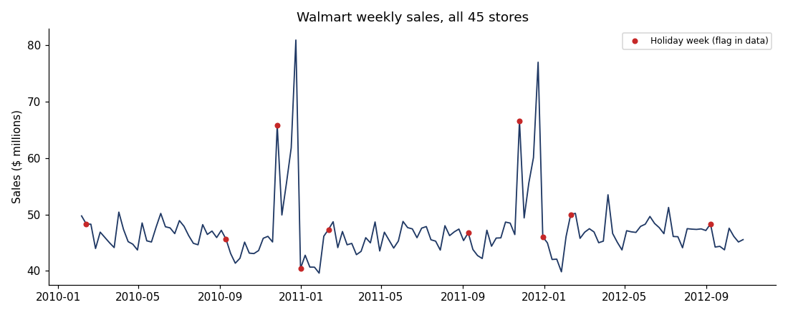
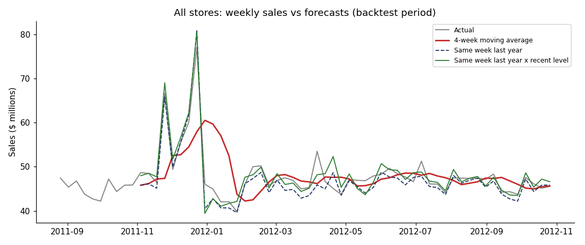

# Walmart sales: ETL pipeline and forecasting

Two parts:

1. A Python ETL pipeline that takes Walmart's three raw files, checks and cleans them, joins them, and loads one table into MySQL.
2. A forecasting comparison that asks a simple question: is a moving average good enough to forecast weekly sales, or do we need something that knows about seasons?

## Data

[Walmart Recruiting – Store Sales Forecasting](https://www.kaggle.com/competitions/walmart-recruiting-store-sales-forecasting/data) on Kaggle. It contains real weekly sales for 45 stores, broken down by department, from February 2010 to October 2012, plus store sizes and some weekly economic data. The competition rules don't allow sharing the files, so they aren't in this repo; `data/README.md` explains how to get them.

## The ETL pipeline

`run_etl.py` runs three steps:

- **extract:** reads `train.csv`, `features.csv` and `stores.csv` (zipped or not)
- **transform:** checks, cleans and joins them
- **load:** replaces the MySQL table in one transaction and logs the run

What the checks found in the real files:

- **421,570 sales rows.** No duplicate store/department/week rows and no missing values. The pipeline checks for both anyway, so bad files would be caught.
- **1,285 weeks with negative sales,** where returns were bigger than sales. These are kept and flagged rather than deleted, because deleting them would overstate sales.
- **21,952 missing markdown (discount) values.** Walmart only started recording markdowns in November 2011, so a missing value really means "no data". They're set to 0, with a column that says whether markdown data existed for that week.
- **1,755 rows in `features.csv` fall in Kaggle's test period,** after the sales data ends, so they're dropped.
- **Every sales row matched its store and its weekly features.**
- **Old Mac line endings:** one copy of `stores.csv` used them, so the extract step normalises line endings before reading.

All 421,570 rows load in about a minute. Running the pipeline again rebuilds the same table, and every run is logged in `etl_runs`. The cleaning rules have tests in `tests/`.

## A few things the data shows



- **Sales are flat from year to year.** An average week between February and October was $46.2M in 2010, $45.8M in 2011 and $47.0M in 2012.
- **The holiday flag in the data misses the biggest weeks.** The two largest weeks are the ones just before Christmas: $80.9M in 2010 and $77.0M in 2011. But the dataset flags the week *after* Christmas as the holiday week.
- **Smaller stores use their space better.** Type C stores are about a quarter of the size of Type A stores, but sell $11.66 per square foot per week compared with $7.77.
- **Some departments are very seasonal.** Department 7's busiest week is 6 times its average week.

The queries are in `sql/analysis_queries.sql`, and the results are saved in `outputs/`.

## Forecasting

Each method predicts next week using only the weeks before it:

- **Naive:** next week = this week
- **MA-4 / MA-8 / MA-12:** the average of the last 4, 8 or 12 weeks
- **Same week last year** (seasonal naive)
- **Same week last year × recent level:** last year's number, scaled by how the last 4 weeks compare with the same 4 weeks a year earlier. This is meant to keep the seasonal shape but adjust for growth or decline.

I tested them on the last 52 weeks of data (November 2011 to October 2012), so the test includes a full holiday season. The score is MAPE, the average percentage miss. Lower is better.

| | Naive | MA-4 | MA-8 | MA-12 | Same week last year | × recent level |
|---|---|---|---|---|---|---|
| All stores | 6.9% | 7.4% | 7.3% | 7.2% | 3.3% | **3.2%** |
| Type A stores | 7.2% | 7.5% | 7.5% | 7.2% | **3.2%** | **3.2%** |
| Type B stores | 7.3% | 8.3% | 8.9% | 8.8% | **3.7%** | **3.7%** |
| Type C stores | 4.8% | 3.5% | 3.6% | 3.7% | 4.8% | **1.8%** |



What this told me:

- **Moving averages work in normal weeks but break around the holidays.** Their error is 3.4–4.2% in ordinary weeks, but 17–19% from November to January. They react late to the spike and then stay too high after it.
- **"Same week last year" works because Walmart's sales repeat almost exactly every year.**
- **The scaled version helps most where the level is changing.** For all stores it only improves things slightly (3.3% → 3.2%). For Type C stores, which a plain moving average handled better than last year's numbers, it cuts the error from 3.5% to 1.8%.
- **The difference matters a lot in practice.** For the four weeks after the data ends, the 4-week moving average predicts a flat $46.1M a week. The scaled seasonal forecast predicts $67.0M for Thanksgiving week. Stocking to the moving average would leave shelves empty in the busiest week of the year.

## Running it

You need Python 3.10+ and MySQL 8.

```bash
pip install -r requirements.txt
cp .env.example .env              # your MySQL details
# in MySQL: CREATE DATABASE walmart;
# put train.csv, features.csv and stores.csv in data/
python run_etl.py
python analysis.py
python forecast.py
pytest
```

## Files

- `run_etl.py` – runs extract, transform and load
- `etl/extract.py`, `etl/transform.py`, `etl/load.py` – the three steps
- `sql/schema.sql` – the `weekly_sales` and `etl_runs` tables
- `sql/analysis_queries.sql` – the analysis questions
- `analysis.py` – runs the queries and draws the weekly chart
- `forecast.py` – backtest and the next 4 weeks
- `tests/` – tests for the cleaning rules
